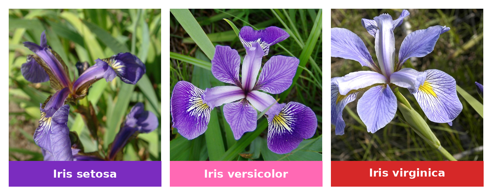
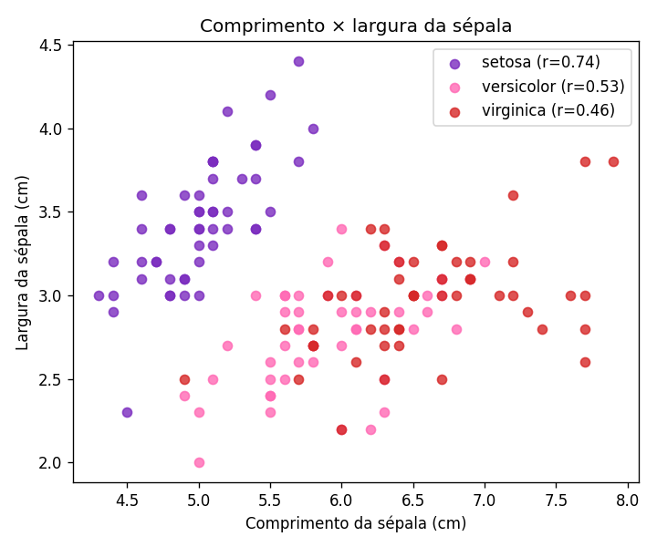
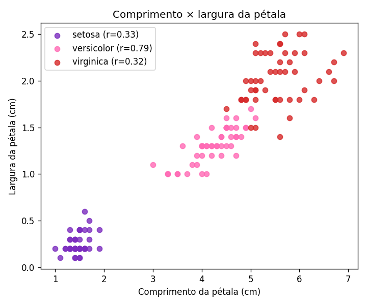
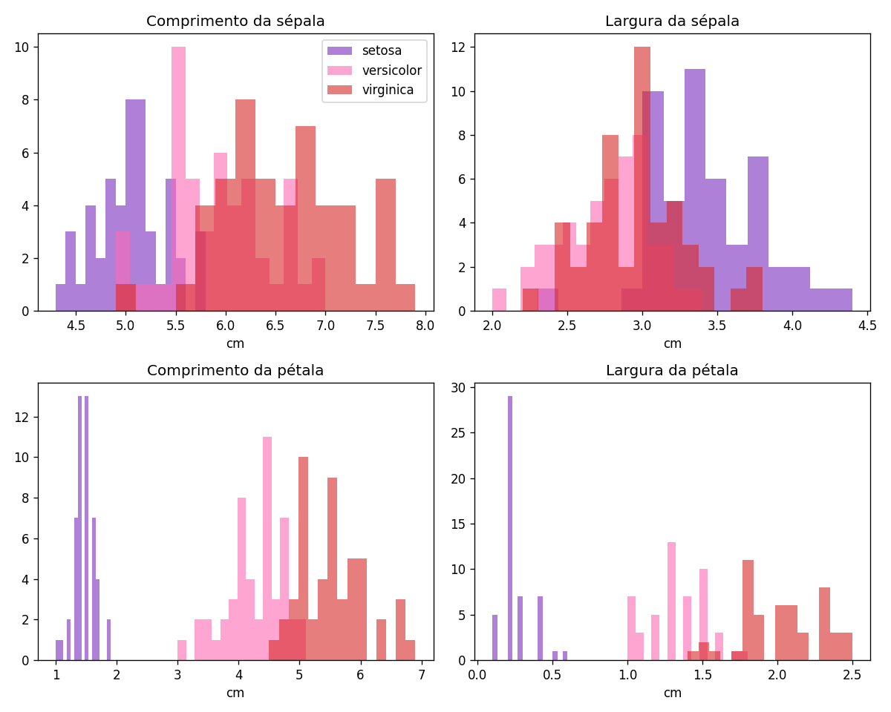
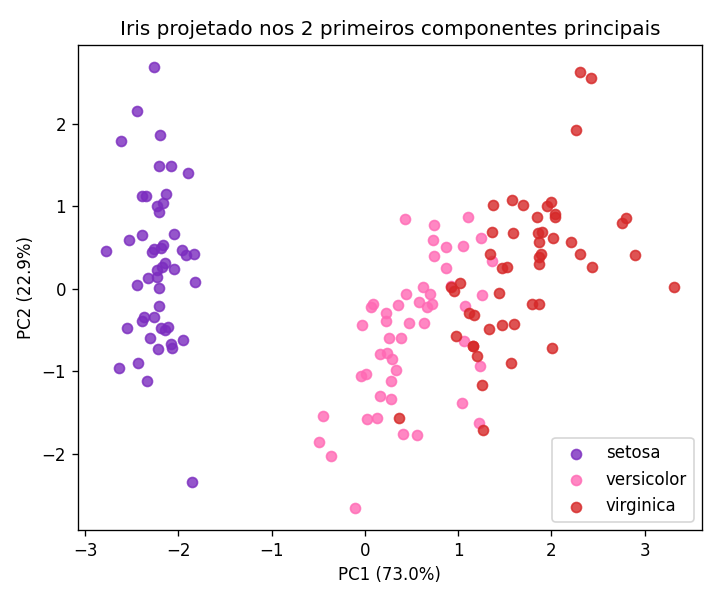
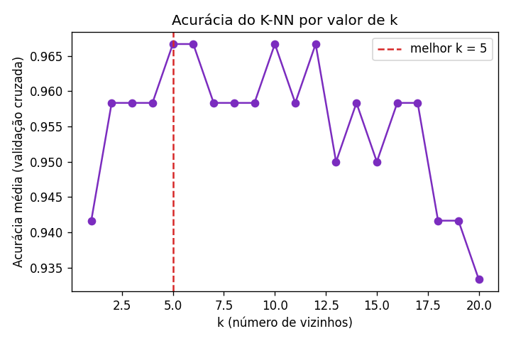
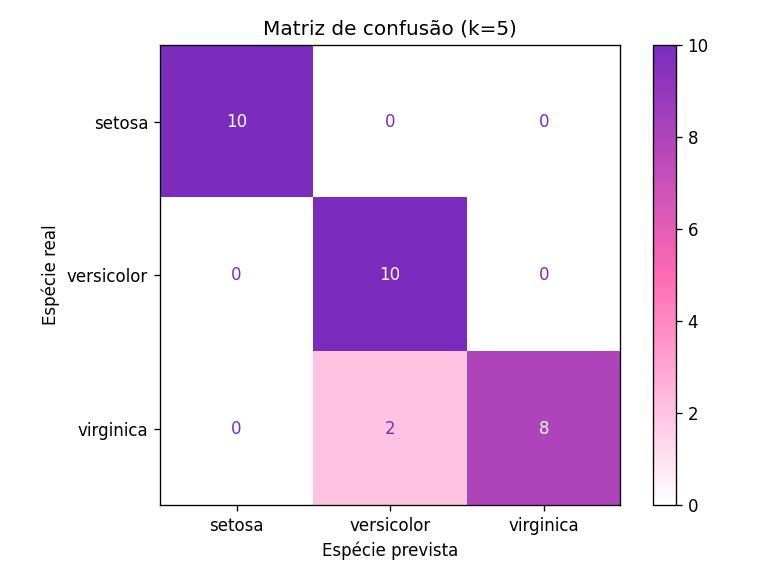

<div align="center">

# Análise e Classificação do Conjunto de Dados Iris com K-NN




</div>

---

## Sobre

Este projeto analisa o conjunto de dados **Iris** ([Fisher, 1936](https://doi.org/10.1111/j.1469-1809.1936.tb02137.x); [UCI Machine Learning Repository](https://archive.ics.uci.edu/ml/datasets/iris)) e classifica suas três espécies de flores com o algoritmo **K-NN** (*k-nearest neighbors*).

O conjunto tem **150 flores**, 50 de cada espécie, descritas por quatro medidas em centímetros:

| Variável | Descrição |
|:--|:--|
| `comprimento_sepala` | Comprimento da sépala |
| `largura_sepala` | Largura da sépala |
| `comprimento_petala` | Comprimento da pétala |
| `largura_petala` | Largura da pétala |

## O que o código faz

| Etapa | O que é feito |
|:--:|:--|
| **1** | Média, desvio padrão e moda de cada variável, no geral e por espécie, e frequência de cada espécie |
| **2** | Relação entre comprimento e largura da **sépala** por espécie (dispersão e correlação de Pearson) |
| **3** | Relação entre comprimento e largura da **pétala** por espécie |
| **4** | Distribuição das espécies nas quatro dimensões (histogramas) |
| **5** | **PCA**: projeção dos dados padronizados em dois componentes principais |
| **6** | Divisão estratificada em **80% treino** e **20% teste** |
| **7** | **K-NN**: escolha de *k* por validação cruzada no treino e avaliação no teste |

## Resultados

### Relação comprimento × largura

A **sépala** separa bem só a setosa. Na **pétala**, as três espécies ficam praticamente separadas.

<p align="center">
  
  
</p>

### Distribuição nas quatro dimensões

As medidas da pétala são as que melhor distinguem as espécies.

<p align="center">
  
</p>

### PCA

Os dois primeiros componentes guardam **95,8%** da variância (PC1: 73,0%, PC2: 22,9%). A setosa fica completamente isolada, e versicolor e virginica se sobrepõem um pouco.

<p align="center">
  
</p>

### K-NN

O melhor *k* na validação cruzada foi **5**. No conjunto de teste, o modelo acertou **28 de 30 flores (93,3%)**. A setosa não teve nenhum erro, e os dois erros foram virginicas classificadas como versicolor.

<p align="center">
  
  
</p>

| Espécie | Precisão | Revocação | F1 |
|:--|:--:|:--:|:--:|
| Setosa | 1,00 | 1,00 | 1,00 |
| Versicolor | 0,83 | 1,00 | 0,91 |
| Virginica | 1,00 | 0,80 | 0,89 |

## Como executar


```bash
pip install pandas matplotlib scikit-learn
```


```bash
python3 analiseClassificacao.py
```

As estatísticas e os resultados aparecem no terminal, e os seis gráficos são salvos como PNG nesta pasta. O dataset não precisa ser baixado: o scikit-learn já traz uma cópia do mesmo conjunto do UCI.

## Estrutura

```
iris_classificacao/
├── analiseClassificacao.py     
├── README.md
├── imagens/
│   └── banner.png              
├── relacao_sepala.png
├── relacao_petala.png
├── distribuicao_variaveis.png
├── pca.png
├── knn_acuracia_por_k.png
└── knn_matriz_confusao.png
```

## Referências

- Fisher, R. A. *The use of multiple measurements in taxonomic problems*. Annals of Eugenics, 7(2), 179–188, 1936.
- Cover, T.; Hart, P. *Nearest neighbor pattern classification*. IEEE Transactions on Information Theory, 13(1), 21–27, 1967.
- Pedregosa, F. et al. *Scikit-learn: Machine Learning in Python*. Journal of Machine Learning Research, 12, 2825–2830, 2011.

## Créditos das fotos

- *Iris setosa*: Radomil, [CC BY-SA 3.0](https://commons.wikimedia.org/wiki/File:Kosaciec_szczecinkowaty_Iris_setosa.jpg)
- *Iris versicolor*: Dlanglois, [CC BY-SA 3.0](https://commons.wikimedia.org/wiki/File:Iris_versicolor_3.jpg)
- *Iris virginica*: Frank Mayfield, [CC BY-SA 2.0](https://commons.wikimedia.org/wiki/File:Iris_virginica.jpg)
